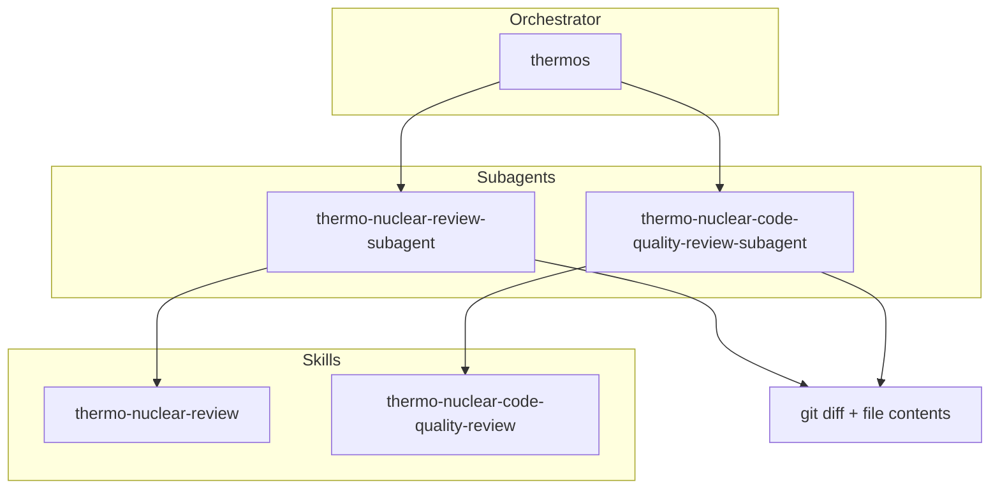

# Thermos plugin

Thermo-nuclear branch review for coding agents: deep correctness and security audits, harsh
maintainability rubrics, and parallel subagent orchestration. Runs in Cursor, Claude Code,
opencode, Pi, and Codex.

## Installation

### Codex

From this checkout's root, register the marketplace and install Thermos:

```bash
codex plugin marketplace add .
codex plugin add thermos@plugins
```

Start a new Codex thread and select `thermos` from the skill picker for the combined
review. The two individual review skills are also available. Codex uses its native
subagents with the bundled review instructions; the Markdown agent files do not
register new Codex agent types. Parallel review requires delegation tools in the
session. See [Codex host behavior](codex.md) and the [repository installation guide](../README.md#codex).

### Cursor

```bash
/add-plugin thermos
```

### Claude Code

Register this repository as a marketplace, then install the plugin:

```bash
claude plugin marketplace add alandotcom/plugins
claude plugin install thermos@plugins
```

Use a local checkout instead of the GitHub source by passing its path to
`claude plugin marketplace add`. Restart Claude Code, then run `/thermos:thermos` for the double
review, or `/thermos:thermo-nuclear-review` and `/thermos:thermo-nuclear-code-quality-review` for a
single pass.

### OpenCode

`thermos/opencode/` registers the shared skills and agents through the OpenCode V2
plugin API. It supplies OpenCode-specific dispatch instructions and absolute rubric
paths while preserving the host's reviewer model and permission configuration.

```bash
opencode plugin add github:alandotcom/plugins
```

The root package loads the `alandotcom.plugins` bundle with Thermos and pstack.
Thermos's three skills and both subagents retain their IDs and model settings.
The agent files remain shared across hosts.

For local development, add the absolute path of `thermos/opencode` to the existing
`plugins` array in `opencode.json`:

```json
{
  "plugins": ["/absolute/path/to/plugins/thermos/opencode"]
}
```

Run `/thermos <review scope>` for the combined review. The command loads the
packaged `thermos:thermos` skill, which you can also select directly. The two
rubrics use the IDs `thermos:thermo-nuclear-review` and
`thermos:thermo-nuclear-code-quality-review`. These IDs avoid collisions with
skills discovered from other hosts. The shared workflow reads
[host-specific dispatch instructions](hosts.md); OpenCode receives its own guide
directly from the plugin. The review rubrics are shared across hosts.

Use either the repository bundle or the local Thermos adapter. Remove an earlier
local Thermos entry before installing the bundle to avoid repeated registrations.

The shared agents inherit the host model. To select a reviewer model, use an ID
that your opencode provider can resolve in `opencode.json`:

```json
"agents": {
  "thermo-nuclear-review-subagent": { "model": "openrouter/openai/gpt-5.6-sol#high" },
  "thermo-nuclear-code-quality-review-subagent": { "model": "openrouter/openai/gpt-5.6-sol#high" }
}
```

Any model id your `opencode.json` resolves works here; the ids above are an example. A review
reads a whole diff and the files around it, so a model with a large context window and a high
reasoning setting suits both subagents.

### Pi

Pi loads skills from `~/.pi/agent/skills/` and reviewer agents from
`~/.pi/agent/agents/` when a delegation extension is enabled. Expose this checkout
with symlinks. These commands create resource links without changing Pi settings:

```bash
THERMOS_ROOT=/absolute/path/to/plugins/thermos
mkdir -p "$HOME/.pi/agent/skills" "$HOME/.pi/agent/agents"

for skill in thermos thermo-nuclear-review thermo-nuclear-code-quality-review; do
  ln -s "$THERMOS_ROOT/skills/$skill" "$HOME/.pi/agent/skills/$skill"
done

for agent in thermo-nuclear-review-subagent thermo-nuclear-code-quality-review-subagent; do
  ln -s "$THERMOS_ROOT/pi/agents/$agent.md" "$HOME/.pi/agent/agents/$agent.md"
done
```

The commands expect unused destination paths. If a path already exists, inspect
and back it up before replacing it. Pi-specific agent files use the
`azure-openai-responses/gpt-6.1-sol` model with the `thinking: high` setting and read the shared
review instructions. Choose an available model in those Pi agent files if needed; Cursor,
Claude Code, OpenCode, and Codex retain their own model configuration.

Restart Pi after creating the links. Run the combined review with `/skill:thermos`; the individual
review skills are available as `/skill:thermo-nuclear-review` and
`/skill:thermo-nuclear-code-quality-review`. The `thermos` skill uses the extension's parallel
delegation tool to run both reviewers. See [Pi host dispatch](hosts.md#pi) for
TintinWeb's `Agent` tool and the `subagent` extension variant.

## Architecture



## Skills

| Skill | Description |
|:------|:------------|
| `thermo-nuclear-review` | Deep branch audit (bugs, breakages, security, devex, feature-gate leaks). |
| `thermo-nuclear-code-quality-review` | Strict maintainability audit (code-judo, 1k-line rule, spaghetti, boundaries). |
| `thermos` | Run both review subagents in parallel and synthesize findings. |

## Agents

| Agent | Description |
|:------|:------------|
| `thermo-nuclear-review-subagent` | Task subagent for deep review rubric (diff-scoped). |
| `thermo-nuclear-code-quality-review-subagent` | Task subagent for code-quality rubric (diff-scoped). |

## Typical usage

**Double review (thermos):**

1. Gather `git diff main...HEAD` and the full contents of the changed files.
2. Call both subagents in one message so they run at the same time.
3. Synthesize prioritized, deduplicated findings.

**Single skill:** run `thermo-nuclear-review` or `thermo-nuclear-code-quality-review` in the main
agent, or call the matching subagent after gathering the diff context.

Each host names the subagent tool differently. Claude Code uses `Agent` with `subagent_type`, Cursor
uses `Task` with `run_in_background: true`, and opencode uses `task`. Pi uses the subagent extension's
custom `subagent` tool with `tasks` and `agentScope: user`. Codex uses native children
with absolute paths to the bundled instructions. The orchestrator selects the
dispatch method for the active host.

## Migration from cursor-team-kit

`cursor-team-kit` previously included only `thermo-nuclear-code-quality-review`. That skill and agent now live in **Thermos** alongside deep review and `thermos`. Remove the old thermo entries from team-kit when you install this plugin to avoid duplicates.

## License

MIT
