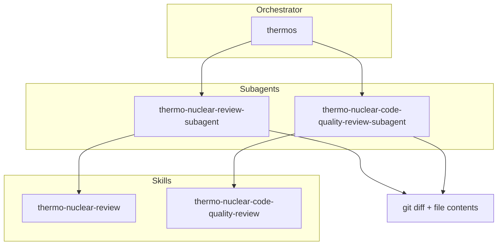

# Thermos plugin

Thermo-nuclear branch review for coding agents: deep correctness and security audits, harsh
maintainability rubrics, and parallel subagent orchestration. Runs in Cursor, Claude Code and
opencode.

## Installation

### Cursor

```bash
/add-plugin thermos
```

### Claude Code

Register this repository as a marketplace, then install the plugin:

```bash
claude plugin marketplace add alandotcom/plugins
claude plugin install thermos@cursor-plugins
```

Use a local checkout instead of the GitHub source by passing its path to
`claude plugin marketplace add`. Restart Claude Code, then run `/thermos:thermos` for the double
review, or `/thermos:thermo-nuclear-review` and `/thermos:thermo-nuclear-code-quality-review` for a
single pass.

### opencode

opencode reads no plugin manifest, so `thermos/opencode/` is a small opencode plugin that hands it
the same `skills/` and `agents/` directories Claude Code loads:

```bash
opencode plugin add github:alandotcom/plugins
```

That resolves the repository's root `package.json`, whose `main` points at the plugin. Restart
opencode; the three skills and both subagents are then available, and the agent files stay the
single source for both hosts.

To run it from a clone instead, add the absolute path of `thermos/opencode` to the `plugin` array in
`opencode.json`. `opencode plugin add` rejects a local path.

Pin a model for the subagents in `opencode.json`, since the shared agent files carry no
opencode-specific model id:

```json
"agents": {
  "thermo-nuclear-review-subagent": { "model": "openrouter/openai/gpt-5.6-sol#high" },
  "thermo-nuclear-code-quality-review-subagent": { "model": "openrouter/openai/gpt-5.6-sol#high" }
}
```

Any model id your `opencode.json` resolves works here; the ids above are an example. A review
reads a whole diff and the files around it, so a model with a large context window and a high
reasoning setting suits both subagents.

## Architecture



## Skills

| Skill | Description |
|:------|:------------|
| `thermo-nuclear-review` | Deep branch audit (bugs, breakages, security, devex, feature-gate leaks). |
| `thermo-nuclear-code-quality-review` | Strict maintainability audit (code-judo, 1k-line rule, spaghetti, boundaries). |
| `thermos` | Run both review subagents in parallel and synthesize findings. |

## Agents

| Agent | Description |
|:------|:------------|
| `thermo-nuclear-review-subagent` | Task subagent for deep review rubric (diff-scoped). |
| `thermo-nuclear-code-quality-review-subagent` | Task subagent for code-quality rubric (diff-scoped). |

## Typical usage

**Double review (thermos):**

1. Gather `git diff main...HEAD` and the full contents of the changed files.
2. Call both subagents in one message so they run at the same time.
3. Synthesize prioritized, deduplicated findings.

**Single skill:** run `thermo-nuclear-review` or `thermo-nuclear-code-quality-review` in the main
agent, or call the matching subagent after gathering the diff context.

Each host names the subagent tool differently. Claude Code uses `Agent` with `subagent_type`, Cursor
uses `Task` with `run_in_background: true`, and opencode uses `task`. The agent files describe all
three, so the orchestrator picks the right one for the host it runs in.

## Migration from cursor-team-kit

`cursor-team-kit` previously included only `thermo-nuclear-code-quality-review`. That skill and agent now live in **Thermos** alongside deep review and `thermos`. Remove the old thermo entries from team-kit when you install this plugin to avoid duplicates.

## License

MIT
